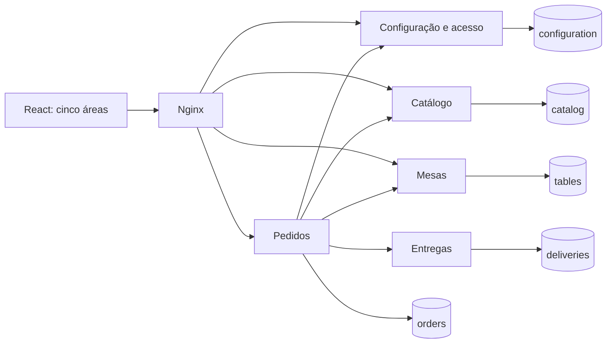

# Arquitetura do Mesa Fácil

Status: Configuração, Acesso, Catálogo, retirada, entrega, Mesas e Comanda estão
implementados, incluindo projeção pública da TV e resumos administrativos nos
[contratos](contracts/http.md). O protótipo permanece independente.

## Organização

Um estabelecimento por instalação. Cada serviço é um processo FastAPI separado,
com banco, usuário PostgreSQL e migrações próprios. Uma instância PostgreSQL é
suficiente. Bibliotecas compartilhadas contêm somente infraestrutura transversal;
modelos ORM, tabelas e regras de negócio pertencem ao serviço responsável.

| Serviço | Dados sob propriedade | Responsabilidade |
| --- | --- | --- |
| configuration | features, revisões, usuários, sessões, admissões | Autorizar acesso e habilitar novas operações |
| catalog | categorias, produtos, revisão e cotações aceitas | Disponibilidade, preço e snapshot de compra |
| orders | pedidos, itens, operações, transições | Coordenar criação e manter estado público canônico |
| deliveries | endereço, taxa e despacho | Persistir os dados específicos da entrega |
| tables | mesas e credenciais de contexto | Validar mesa e acesso do tablet |

Administração, Cliente, Balcão, Comanda e TV são rotas de um frontend React. Nginx
serve esse frontend e encaminha somente APIs públicas. Portas de serviços e banco
não são publicadas no host pelo Compose. `/internal/v1` nunca é exposto no gateway.

Um provider React acompanha a configuração salva a cada três segundos e compartilha
revisão, features e estado de sincronização. Respostas antigas não substituem revisões
mais recentes; rascunhos e efeitos sobre carrinhos permanecem nos seus módulos.
A TV usa uma única instrução SQL para páginas e totais das duas colunas, consultando
apenas Pedidos. Os resumos agregam dados no banco de cada serviço, sem acesso cruzado.

## Modelo de dados e valores

- IDs técnicos: UUID. Número de atendimento: sequência persistente em Pedidos,
  única na instalação e sem significado de autorização. Lacunas são permitidas.
- Dinheiro: inteiros em centavos BRL, nunca float. Taxa de entrega: 500 centavos.
- Item: product_id, name, unit_price_cents, quantity e subtotal_cents registrados
  na compra. Atualizações do catálogo não recalculam pedidos antigos.
- Pedido: id, number, origin (`client`, `counter`, `tablet`), fulfillment
  (`pickup`, `delivery`, `table`), customer_name ou table_id, state, version,
  configuration_revision, catalog_revision, items, fee_cents, total_cents,
  created_at e updated_at. Datas em UTC/RFC3339.
- Configuração: uma linha por estabelecimento, features e revision crescente.
- Catálogo: revision global crescente e preços positivos; quantidade inteira de
  1 a 99 por produto, até 50 produtos distintos por pedido.
- Transição: id, order_id, previous_state, target_state, actor_id e created_at.
- Mesas: id, number único e available; início com 12 mesas demonstrativas.
- Operação: chave de idempotência, hash do payload, principal, progresso, tentativas,
  próxima tentativa e erro sanitizado. Não equivale a pedido confirmado.

## Estados

Retirada e mesa: `received → preparing → ready → completed`.
Entrega: `received → preparing → ready → dispatched → completed`.

Não há regressão, cancelamento ou edição de itens no P0. A criação interna pode
estar `pending`, `succeeded`, `rejected` ou `needs_attention`; essas fases não são
estados operacionais e pedidos incompletos nunca aparecem na fila ou na TV.

## Acesso

A implementação usa sessões opacas revogáveis para administrador e operador,
com hash do token persistido em Configuração. Senhas terão hash apropriado, nunca
texto puro. Sessão interna de usuário via cookie HttpOnly/SameSite e proteção CSRF
nas mutações; Secure obrigatório fora de desenvolvimento HTTP local. Duração
inicial de 8 horas, sem renovação implícita ilimitada.

Cliente recebe contexto anônimo de acesso antes do checkout e só consulta seus
pedidos. O cookie opaco é preservado por até um ano no navegador, com hash no banco
e sem expiração do registro no P0. O contexto permite recuperar uma criação após timeout.
O número sequencial e o UUID, isoladamente, nunca autorizam consulta.

Tablet requer provisionamento pelo operador e credencial restrita à mesa.
A seleção de mesa na demonstração deve gerar um novo contexto autorizado, sem
aceitar um table_id arbitrário como credencial. A TV recebe apenas sua projeção
pública filtrada. APIs internas exigem credenciais de serviço separadas e escopos;
rede privada não substitui autenticação.

## Deploy e variabilidade

Os serviços estarão todos disponíveis no Compose padrão. Profiles de derivação
serão adicionados em T55; habilitar uma feature exige verificar que sua dependência
está instalada. Desabilitar uma feature não desliga serviços nem bloqueia conclusão
de pedidos existentes. Exportação identifica serviços necessários às features;
a implantação também considera operações e pedidos ainda pendentes.

## Referências técnicas consultadas

- [FastAPI: ciclo de vida](https://fastapi.tiangolo.com/advanced/events/)
- [Pydantic Settings](https://github.com/pydantic/pydantic-settings)
